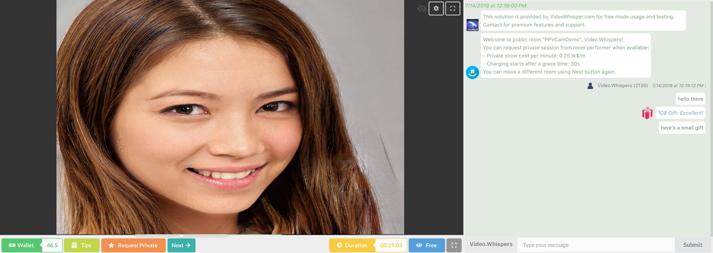

## PHP-HTML5-Videochat / Live Streaming - Standalone PHP
## November 2026 maintenance update

The bundled HTML5 Videochat app is built from source dated **2026.11.10**. The older recorder remains a compatibility example. For small group meetings use [Video Conference](https://demo.videowhisper.com/video-conference/); for webcam, microphone, screen capture and download-only recording use [the current recorder](https://demo.videowhisper.com/webcam-microphone-screen-recorder/). Neither requires Flash.

PHP 8.2+, Fileinfo, mbstring, HTTPS and PHP sessions are required. The example now validates a random browser session secret for every app request. Room roles come from the server session; knowing a room/user ID does not grant broadcaster access. State is stored outside the web root, and account tokens stay on the PHP host. Chat is bounded and recordings have randomized filenames, MIME/size checks, a 25 MB file limit, 100 MB/20 files per booth and 500 MB total upload quota. This remains a public developer demo, without a member/billing system. Accepted recordings are public to visitors with a booth or file URL; use synthetic test content only.

### Configure before installation

Set `VWH5_SOCKET`, `VWH5_ACCOUNT` and `VWH5_TOKEN` on the PHP host. The account token must never be placed in JavaScript, a public JSON file or this repository. Alternatively set `VWH5_CONFIG` to an operator-owned PHP file **outside the document root** that returns an options array containing `vwsSocket`, `vwsAccount` and `vwsToken`. `settings.php` contains safe defaults, not deployment credentials. Set `VWH5_STORAGE_DIR` to a private directory outside the web root; its default is a per-installation private temporary directory. Protect it with owner-only permissions and use a persistent location on public deployments.

In the streaming account, set the login callback to this installation's HTTPS `socket-auth.php` URL. The callback authenticates the server's private token and checks a five-minute, user-bound PIN. The React client renews through `task=socket_auth` after authenticating the browser session. Configure separate accounts for unrelated installations. `uploads/.htaccess` disables indexes, executable content and access to historical session/chat files; configure equivalent rules on non-Apache hosts. Also configure edge rate/connection limits and PHP `post_max_size`/`upload_max_filesize` consistently with the application limit.

Visitor page views no longer delete files. Schedule `php clean_older.php --days=1` using the PHP account. It deletes only expired randomized recordings created by the new uploader, skips symlinks and preserves historical filenames. Review older media separately before migrating or deleting it.

### Verify and update

Run `python3 tests/smoke.py` before publishing; it starts a loopback PHP fixture with synthetic credentials and private temporary storage. The checks cover sessions, guest/owner access, callback rejection, chat and private state. Then test two browser contexts with fake or consented devices, recording upload/playback where applicable, and the host's HTTPS/TURN configuration. Physical devices and separate networks need manual checks.

Human-readable React source, dependency lockfile and build scripts for the bundled assets are in `source/`. In that directory run `npm ci`, `npm run test:socket-auth`, then `NODE_OPTIONS=--openssl-legacy-provider DISABLE_ESLINT_PLUGIN=true GENERATE_SOURCEMAP=false npm run build`. Replace only generated `static/js`, `static/css` and referenced media, keeping license notices. The legacy CRA build toolchain has known development-only audit findings; never expose its development server publicly. Runtime dependency audit passed on 2026-11-10.

Publishing uses an explicit runtime/source allowlist. Exclude `.env*`, editor/SFTP settings, private configuration, uploads, logs, recordings, tests results and dependency folders. Back up the installed runtime and private configuration first, upload the tested assets and PHP files together, verify the version banner and test login/chat/media, and restore the previous runtime if verification fails. Never synchronize customer recordings or delete historical media during an update.

### Live Demos for PHP Live Streaming / HTML5 Videochat : Broadcast & Playback Live Video

[HTML5 Live Video Streaming using P2P WebRTC](https://demo.videowhisper.com/vws-html5-livestreaming/)

Before installing, test the simple setup in the live demos above.

This edition showcases streaming from 1 broadcaster to multiple viewers and chat.
This plain php edition includes code and minimal scripts to embed a HTML5 Videochat app and test/showcase some features. This edition is for integrating/using application with own scripts/framework.
For a complete implementation of advanced capabilities, see [Turnkey HTML5 Videochat Site](https://paidvideochat.com/html5-videochat/) edition, available as WordPress plugin with full php source. The turnkey site edition implements pay per minute videochat (group and private 2 way video calls) with membership, billing, advanced tools.

### Simple PHP Edition Features: Live Streaming: Broadcast & Playback

- [x] Automatically create a room as broadcaster on access and show link to invite participants that will access as viewers
- [x] Embed app to broadcast and playback live video using HTML5 WebRTC
- [x] Simple implementation of signaling broadcast (to connect automatically) and text chat, using plain files

### Key Features for HTML5 Videochat / Live Streaming: Broadcast & Playback

- [x] WebRTC 1 way to many live video streaming, in public lobby
- [x] WebRTC relayed streaming (reliable and scalable to many clients from Wowza SE streaming server, independent of broadcaster upload connection) / P2P using VideoWhisper WebRTC
- [x] select camera, microphone, resolution, bitrate
- [x] screen sharing toggle, with microphone track mixed
- [x] video/audio recorder, emoticons, mentions in text chat
- [x] fullscreen for videochat interface or playback video
- [x] adaptive target video bitrate (depending on cam resolution) and configuration in resolution change
- [x] broadcasting/playback stats (open controls and stats should show in few seconds)
- [x] dark mode / lights on: each user can toggle interface mode live at runtime, SFX (sound effects)
- [x] translation and text change support
- [ ] request private 2 way calls / shows from group chat
- [ ] random videochat with Next button to move to different performer room
- [ ] live wallet balance display (updates from tips and other transfers)
- [ ] tips with multiple customizable options, gift images

Warning: some of these features are not active/implemented in this simplified edition, but can be enabled as in turnkey site edition.

## Installation Instructions

Before installing, make sure your hosting environment meets all [requirements](https://videowhisper.com/?p=Requirements) including the Wowza SE as HTML5 WebRTC streaming relay and/or the [VideoWhisper WebRTC signaling server](https://github.com/videowhisper/videowhisper-webrtc/). Production implementations should also involve Session Control for security and website integration (like list of live channels).
For testing, get a free plan from [WebRTC Host: P2P](https://webrtchost.com/hosting-plans/#WebRTC-Only).

1.  If you don't use a [turnkey webrtc relay streaming host](https://webrtchost.com/hosting-plans/), configure WebRTC + SSL with Wowza SE or the VideoWhisper WebRTC + STUN/TURN server.
2.  Deploy files to your web installation location. (Example: yoursite.domain/html5-videochat/)
3.  Fill your streaming settings in settings.php file
4. Give the PHP account ownership of its private state directory (0700). Public recording files use 0755 directories and 0644 files; do not use world-writable permissions.

## Plain PHP Edition Limitations

- The plain php edition refers to minimal scripts for configuring and accessing videochat room, so developers can integrate with own scripts.
- Plain php edition does not involve database and systems to manage members, rooms, billing. These depend on framework you want to integrate, plugins, database, member system.
- Applications reads parameters, wallet balance and other data with ajax calls from framework/integration scripts (that need to be implemented depending on framework, database, user scripts).
- A complete implementation of features is available for WordPress framework. See [Turnkey HTML5 Videochat Site](https://paidvideochat.com/html5-videochat/) edition, available as WordPress plugin with full php source. Includes user role management (performers/clients), pay per minute, integrates billing wallets.
- Plain edition implements 1 way streaming and chat with broadcast / playback screens for broadcaster and other participants. Application supports but this edition does not implement signaling for requesting 2 way video calls or parameters and content for conference/collaborations.
- Setup starts in demo mode, to prevent high resource usage by visitors. To enable and confirm full mode you need to fill application version in modeVersion parameter. [Consult VideoWhisper](https://consult.videowhisper.com) for assistance or a turnkey site setup.

## Main Integration Scripts

- index.php embeds the html5 application: accessed directly creates a room and shows room link to invite others
- app-call.php is called by application to retrieve parameters, interact with web server, update status and chat (ajax calls)
- app-functions.php functions implementing features for app-call.php , including translated texts, app settings
- settings.php settings and options, including streaming settings and url for calls (when integrating with own framework)

Scripts also contain comments for clarifications/suggestions.

This is a simple setup showcasing easy app deployment and integration with other PHP scripts.
For a quick setup, see [VideoWhisper Turnkey Stream Hosting Plans](https://webrtchost.com/hosting-plans/) that include requirements for all features and free installation.

### VideoWhisper HTML5 Project Demos

- [Video Call PHP / HTML5 Videochat on VideoWhisper WebRTC](https://demo.videowhisper.com/p2p-html5-videocall/)

- [Live Streaming PHP / HTML5 Videochat on VideoWhisper WebRTC](https://demo.videowhisper.com/vws-html5-livestreaming/)
- [Cam/Mic Recorder HTML5 - Standalone](https://demo.videowhisper.com/cam-recorder-html5-video-audio/)
- [PaidVideochat Turnkey Site](https://paidvideochat.com/demo/)

### VideoWhisper HTML5 Project Downloads

- [Video Call - HTML5 Videochat - GitHub](https://github.com/videowhisper/VideoCall-HTML5-Videochat-PHP)
- [Live Streaming - HTML5 Videochat - GitHub](https://github.com/videowhisper/HTML5-Videochat-PHP)
- [Cam/Mic Recorder HTML5 - GitHub](https://github.com/videowhisper/Cam-Recorder-HTML5-Video-Audio)
- [PaidVideochat Turnkey Site - WordPress](https://wordpress.org/plugins/ppv-live-webcams/)
- [Video Calls & Random Chat Turnkey Site - WordPress](https://wordpress.org/plugins/webcam-2way-videochat/)
- [WebRTC Signaling Server](https://github.com/videowhisper/videowhisper-webrtc/)

[Consult VideoWhisper](https://consult.videowhisper.com) for commercial services like turnkey site platforms, compatible hosting, custom development services.
